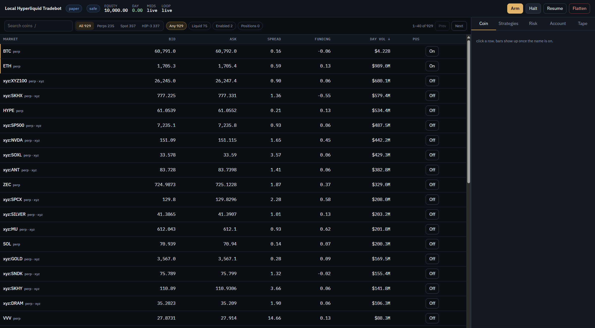

# Local Hyperliquid Trading Bot

A trading desk for Hyperliquid that runs on your computer. You choose the coins, the strategy, and the risk. The bot watches the live book and places the order. Fills stay on this machine until you connect an agent and arm the desk.



## What it does

- Covers Hyperliquid perps, spot, and HIP-3 from one local page. BTC and ETH start on. The rest stay off until you turn them on.
- Runs one strategy at a time. EMA, RSI, MACD, Bollinger, and Donchian ship with the example. You can add your own, including a plain rule list.
- Sizes the trade from the risk you set, then cuts it to the book, the spread, your free margin, and the daily loss limit.
- Sets leverage per coin, from 1x up to that coin's maximum on the exchange. 1x is the default, and the size stays inside equity. The top of the slider is marked: liquidation sits close to the price.
- Sends a reduce-only stop with the entry. A target is optional. Flatten closes an open position without flipping you the other way.
- Paper, testnet, and live are the same desk. Paper reads real prices and does not send orders. Testnet and live need an agent key. Live will not arm until an empty file named `ARM` is in the project folder. That file is only a safety latch. It is not a password.

The master private key does not belong in the bot, the config, or the page. The agent signs orders. It cannot withdraw, and it cannot move USDC to the spot wallet.

## How it works

1. Start the program. It prints a local address and a token. Open the page, paste the token. The page listens on `127.0.0.1` only.
2. Stay on paper. Pick the bar size, leave one strategy on, and check the risk numbers. Arm when you want new entries. Halt blocks new entries and still lets exits run. Disarm stops entries and leaves the position until you flatten or a stop fills.
3. Connect an agent when paper looks right. Do testnet before live. Connect does not arm the desk. On live, the `ARM` file has to be in the folder first. The agent key stays in memory for that run and is gone after a restart.

The strategy only asks. A stale quote, a thin book, a stop on the wrong side, or a position already close to liquidation will still drop the order. The reason shows on the Tape.

## The ARM file

This file exists only for safety. It is not a key, not a password, and not a config. The bot does not read what is written in it. On live, when you press Arm, it checks that a file named `ARM` is sitting in the project folder. If the file is missing, Arm does nothing and no live entry is sent. Paper and testnet do not look for it.

The agent key already lets the program sign orders. Arm is one click on the page. A click is easy to hit by mistake, or to leave armed, or for someone else at the keyboard to press. The file is the extra step you have to mean. You create it when you are ready for real orders. You delete it when you are not. A loaded key, by itself, cannot arm live.

From the project folder:

```
New-Item ARM -ItemType File
```

On Linux or Mac, `touch ARM`. The file can be empty.

Delete `ARM` when you want live arming turned off. The check happens when you press Arm, not on every order. If the desk is already armed, press Disarm or stop the program as well. Do not commit the file. It is in `.gitignore` on purpose. If it were in the repo, every copy would already be allowed to arm live.

## Install

Python 3.12 or newer.

```
py -3 -m venv .venv
.venv\Scripts\activate
pip install -e .
```

On Linux or Mac, activate with `source .venv/bin/activate`. Use `python3` if you don't have `py`.

Copy the example so you can edit your own file:

```
copy config.example.toml config.toml
```

(`cp config.example.toml config.toml` on Linux or Mac.)

## Run

```
py -3 -m hlbot run --config config.toml
```

The terminal prints the address and a token, something like:

```
markets 929
paper http://127.0.0.1:8787
token 3f9c...
```

Open the address and paste the token. If you want a fixed token, set it before start.

PowerShell:

```
$env:HLBOT_TOKEN="desk-token"
py -3 -m hlbot run --config config.toml
```

cmd.exe is `set HLBOT_TOKEN=desk-token`. Bash is `export HLBOT_TOKEN=desk-token`.

The page listens on `127.0.0.1` only. Another computer on the network cannot open it. `--expose` removes that limit. Don't use it on a machine other people can reach. The token is the only login.

Check the file without starting the bot:

```
py -3 -m hlbot check --config config.toml
```

## On the page

The buttons, and when to press them, are in [admin.html](admin.html). Open that file in a browser.

BTC and ETH are already on. The other names are off. Leave it like that until the page looks right. A thin book can be refused. The button will ask before it turns a thin name on anyway.

Five strategies come with the example config. EMA 9/21 is the one that is enabled. RSI, MACD, Bollinger and Donchian are there, but off. Press Use to switch. Only one stays on.

You can add your own from the form (EMA, RSI, MACD, Bollinger, Donchian). Advanced is the raw JSON, if the form is not enough. A new strategy is saved off.

Hover a field when you don't remember what it does.

Arm means new entries are allowed. In paper they still fill on this computer. Disarm stops new entries. Positions that are already open stay until you flatten, or a stop fills.

Halt also stops new entries. Exits still go. Resume turns entries back on.

Flatten closes what is open, reduce-only.

The numbers at the top (equity, day pnl, quote age, loop) are the paper account until you connect a real one. "live" next to the quote means the price is fresh. It does not mean the account is live.

## Risk

Values in `config.toml` can only get tighter. A looser number is rejected and the old limits stay.

The program will not go past this, even if the file says so:

- each coin starts at 1x. a perp can be raised up to that coin's own exchange maximum, from the coin pane. the maximum shows a warning
- one order, 3x equity, and only as far as the leverage allows
- one coin, 3x
- gross exposure, 3x equity
- daily loss, 10%
- slippage, 8 bps

The example file is already inside those lines. Leverage starts at 1, one order 10%, daily loss 3%, day volume at least 5M, spread at most 8 bps.

1x keeps the size inside equity. A higher number on a coin borrows, and the exchange is set to that number before an entry. The slider stops at the maximum that coin has on the exchange, and that top setting is marked because the liquidation sits close to the price. Cross is the default. Isolated is a switch on the risk tab. A coin that only allows isolated stays isolated either way. If a position already open is closer to its liquidation than the liq distance, a new entry is skipped. A position that is already open is updated on the next loop.

Opens under about $10 are skipped. Closes are not. Spot cannot be shorted.

If the quote is older than `stale_ms` (1500 in the example), a new entry is refused. Closes are still allowed.

## A real account

Do the testnet first.

On Hyperliquid, create an API agent wallet. Keep the agent private key. You also need the main account address (`0x` and 40 hex characters). Leave the main private key out of this bot, and out of the chat, and out of the config file.

Then in the page, Account:

- mode: Testnet or Live
- account: that `0x` address
- vault: only if you use a vault
- agent key
- Connect

The key stays in memory for this run. It is not written to the config, the log, or the page. After a restart you connect again.

Connect does not arm anything. Testnet does not need `ARM`. Live does. Create that file the way the section above describes, then press Arm.

There is a second way. Put this in `config.toml`:

```
mode = "live"
account = "0xYOUR_ADDRESS"
```

and start with the agent key in the environment:

```
$env:HL_AGENT_KEY="0xYOUR_AGENT_KEY"
py -3 -m hlbot run --config config.toml
```

You still create `ARM` before Arm. The Account tab is easier, because the key does not stay in the shell history.

`ARM`, `state/` and `*.db` are in `.gitignore`. Don't commit them. Don't commit a config that has a key in it. The example config does not.

## Strategy example

Blank `coins` means every name you enabled on the page.

```toml
[[strategy]]
name = "ema"
kind = "ema"
enabled = true
coins = []
fast = 9
slow = 21
atr_len = 14
stop_atr = 1.8
take_r = 3
risk_frac = 0.004
max_hold_bars = 16
funding_block = 0.0003
```

`risk_frac` cannot be higher than 0.02. The name `guard` is already used by the bot.

A Donchian rule list, left off:

```toml
[[strategy]]
name = "btc_break"
kind = "rules"
enabled = false
coins = ["BTC"]
risk_frac = 0.004
stop_atr = 1.8
take_r = 3
rules = [
  { side = "buy", when = "close_gt_donchian_high", donchian = 20 },
  { side = "sell", when = "close_lt_donchian_low", donchian = 20 },
]
```

The bar size starts at 15 minutes. On Strategies there is a dropdown if you want 1m, 5m, 1h, 4h, 1d, or the others in that list. Switching throws away the bars already loaded. The strategy still only asks. Size, spread, a stale book and the daily loss limit can still drop the order.

## Other

`state/journal.db` is a small local log. `state/heartbeat` is the last time the loop ran.

```
py -3 -m hlbot guard --heartbeat state/heartbeat
```

This only prints ok or stale. It does not close positions.

Tests, if you installed with the dev extra (`pip install -e ".[dev]"`):

```
py -3 -m pytest
```
